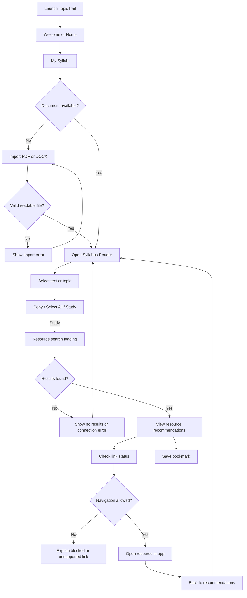

# TopicTrail: User Flow and Mobile Information Architecture

**Status:** Proposed functional flow based on the approved TopicTrail concept and its Figma design. Exact prototype links and error handling must be verified against the finalized Figma file and implemented Flutter application.

## Main Highlight-to-Study flow

## Screen map

| Screen or state | Main purpose | Common next action |
| --- | --- | --- |
| Splash | Load brand and route to app | Welcome or Home |
| Welcome | Introduce the application | Get Started → Home |
| Home | Access documents and study tools | Upload or My Syllabi |
| Upload Syllabus | Choose and import a file | Reader or My Syllabi |
| My Syllabi | Browse imported files | Open reader; rename or delete |
| Document Reader | Read and select syllabus text | Copy, Select All, Study |
| Text Selection Menu | Act on selected text | Study → Loading |
| Resource Search | Communicate progress | Results, empty state, or error |
| Recommendations | Review related resources | Open or Save |
| In-App Viewer | Read a supported website | Back to results/reader |
| Saved Resources | Reopen bookmarked links | Open or remove bookmark |
| Settings | Adjust preferences | Choose theme and return |

## Secondary flows

### Document management

1. Go to **My Syllabi**.
2. Choose **Upload** to import a new PDF/DOCX, or open an existing document.
3. Use supported management actions such as rename or delete.
4. Confirm destructive actions to avoid accidental deletion.

### Saved resources

1. From a recommendation, choose **Save**.
2. Open **Saved Resources** from navigation.
3. Select an item to reopen it; choose **Remove** to delete the bookmark.
4. Return to the linked syllabus topic where feasible.

### Settings

1. Open **Settings**.
2. Select Light, Dark, or System theme.
3. Apply and persist the selection locally.
4. Return to the previous screen.

## Error and alternative paths

- **Unreadable or unsupported file:** Explain why and allow another selection.
- **Scanned or image-only PDF:** Explain that text selection is unavailable without OCR.
- **Empty selection:** Keep Study unavailable until text is selected.
- **Offline or search failure:** Explain the problem and allow retry.
- **No useful results:** Show a meaningful empty state, not invented results.
- **Unsafe or unsupported URL:** Block navigation and give an understandable reason.
- **Website cannot be embedded:** Offer a compliant alternative if permitted, without bypassing restrictions.
- **No saved resources:** Offer a helpful empty state linking to the study flow.

## Implementation cautions

- Actual Copy, Select All, and Study menu behavior can vary by document-rendering package and Android platform.
- Resource discovery requires a real permitted provider; do not simulate live results with hardcoded content.
- URL screening is limited; never imply guaranteed safety.
- Returning to an exact document position should be tested and documented.

## Figma reference

[Finalized TopicTrail mobile UI and prototype](https://www.figma.com/design/K7G68R3vNSWiNuRF1I3o0o/TopicTrail-%C2%B7-Team-JAM--C-6--%C2%B7-Mobile-UI---Prototype?node-id=2-5)

A final frame-by-frame navigation audit should be performed before Flutter UI implementation.
